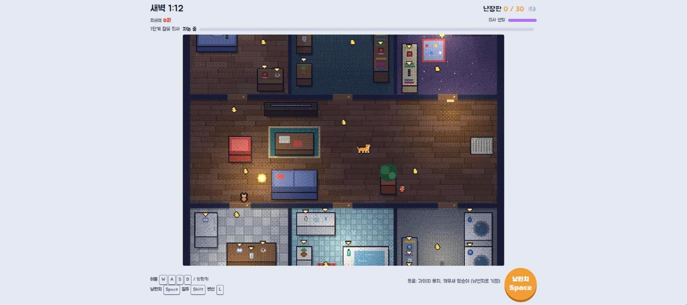
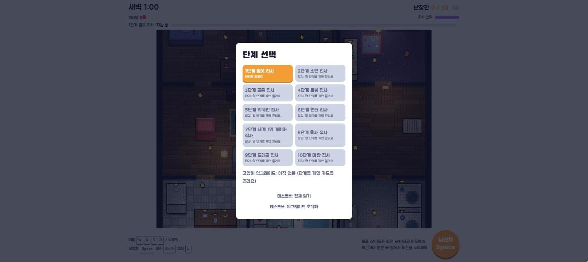

# 고양이 vs 집사 — 1단계 프로토타입

플레이어가 고양이가 되어 밤사이 집 안 물건을 떨어뜨리고, 컴퓨터가 움직이는 집사가 소리를 듣고 깨어나 고양이를 쫓아와 이동장에 가두는 탑다운(위에서 내려다보는) 2D 픽셀 게임입니다. 제한 시간 3분(게임 속 새벽 1:00~4:00) 안에 물건 36개 중 30개를 떨어뜨리면 그 단계를 깹니다.

- 바로 보기: https://develop-korea-tech.github.io/yaong/
- 형태: 단일 HTML 파일(`index.html`) · 설치 없음 · PC(키보드·마우스)와 휴대폰(터치) 모두 지원
- 기술: HTML · CSS · JavaScript(Canvas 2D, Web Audio API) · 외부 라이브러리 없음(글꼴만 Google Fonts의 Black Han Sans, Jua 사용)
- 만든 시기: 2026-10 (마지막 업로드 기준)
- 상태: 브라우저 탭 제목대로 프로토타입입니다. 단계 10개를 모두 플레이할 수 있지만 점수 기록·순위표는 없고, 단계 선택 화면에 테스트용 버튼이 남아 있습니다([6. 알려진 제약](#6-알려진-제약) 참고).

| 1단계 플레이 화면 — ▼ 표시가 있는 물건을 떨어뜨려 난장판 점수를 올립니다 | 단계 선택 화면 |
|---|---|
|  |  |

## 1. 주요 기능

### 1-1. 게임 규칙

- 한 판은 게임 시간 180초(`ROUND_SEC`)입니다. 위쪽 시계는 1초에 1분씩 새벽 1:00에서 4:00까지 갑니다.
- 물건 30개(`TARGET`)를 떨어뜨리면 클리어, 그 전에 4:00이 되면 실패("아침이 됐다")입니다.
- 집사는 침대에서 자다가 소음이 쌓이면 깨어나 소리 난 곳으로 오고, 고양이가 보이면 쫓아와 잡습니다. 잡히면 이동장에 5초(`CAGE_SEC`) 갇혔다가 이동장 옆에서 다시 움직입니다. 잡혀도 판은 끝나지 않고 시간만 잃습니다.
- 물건마다 가격(`PRICE`, 500원~5,000만 원)이 있어 떨어뜨릴 때마다 피해액이 쌓이고 집사 멘탈(0~100)이 깎입니다. 멘탈이 0이 되면 집사가 5초 동안 "멘붕"으로 주저앉았다가 멘탈 70으로 돌아옵니다.
- 2.4초(`COMBO_GAP`) 안에 연달아 떨어뜨리면 콤보가 오르고, 콤보가 높을수록 멘탈이 더 많이 깎입니다.
- 1단계 아파트는 가운데 거실과 문이 달린 방 6개(안방·서재·아이방·주방·욕실·세탁실)로 되어 있고, 물건 36개는 모두 방 안 가구 위에 있습니다. 그래서 먼저 닫힌 문을 긁어서 열어야 합니다.
- 결과 화면에는 칭호, 피해액, 집사 멘붕 횟수, 잡힌 횟수, 최고 콤보가 나옵니다. 칭호는 `titleOf()`가 아래 순서로 처음 맞는 조건을 고릅니다.

| 결과 | 조건 | 칭호 |
|---|---|---|
| 클리어 | 피해액 200만 원 이상 | 재난 그 자체 |
| 클리어 | 한 번도 안 잡힘 | 완전범죄 냥아치 |
| 클리어 | 120초 안에 클리어 | 파괴 스피드런 장인 |
| 클리어 | 집사 멘붕 2번 이상 | 집사 멘탈 브레이커 |
| 클리어 | 그 밖 | 동네 소문난 냥아치 |
| 실패 | 6번 이상 잡힘 | 이동장 VIP 회원 |
| 실패 | 떨어뜨린 물건 10개 미만 | 집사의 착한 아이 (실망) |
| 실패 | 그 밖 | 아쉬운 반쪽짜리 재난 |

### 1-2. 단계 구성 (10단계)

단계마다 집사(그림·속도·성격·기술 2개), 지도, 물건 종류, 동료, 방해요소가 바뀝니다. 처음에는 1단계만 열려 있고, 단계를 깨면 다음 단계가 열립니다. 고양이 기본 속도는 초당 52px, 집사가 쫓는 속도는 단계에 따라 초당 48~51px입니다(px는 지도 좌표 기준이며 지도 전체는 360×380px입니다).

집사는 기술을 쓰기 전에 바닥에 예고 표시(원·점선·부채꼴)를 띄우고, 0.4~1.2초 뒤에 발동합니다. 예고 표시를 보고 그 범위 밖으로 피하면 됩니다.

| 단계 | 집사 · 무대 | 성격 | 기술 1 | 기술 2 |
|---|---|---|---|---|
| 1 | 잠옷 집사 · 평범한 아파트 | 쫓다가 4초 만에 포기 | 빨래바구니: 빨간 원 안에 있으면 바로 이동장 | 슬리퍼: 날아오는 슬리퍼에 맞으면 1초 묶임 |
| 2 | 소인 집사 · 소인국 미니어처 마을 | 집사가 깨면 동료 전원이 고양이 쪽으로 출동 | 소인 부대: 3명을 불러 쫓게 함, 달라붙으면 1.5초 느려짐 | 그물: 원 안이면 1.2초 묶임 |
| 3 | 곤충 집사 · 숲속 버섯 오두막 | 자거나 걷는 집사 45px 안에서 빨리 움직이면 소음 발생 | 거미줄: 맞으면 1.5초 묶임 | 꿀 장판: 6초간 남는 장판, 그 위에서 이동 속도 0.35배 |
| 4 | 로봇 집사 · 비밀 연구소 | 쫓다가 10초 만에 포기, 0.6초 만에 깸 | 자석 견인: 맞으면 1초간 집사 쪽으로 끌려감 | 충격파: 집사 주변 48px, 맞으면 튕겨나가며 1초 묶임 |
| 5 | 외계인 집사 · 우주선 | 50px 안이면 벽 너머도 봄 | 순간이동: 고양이가 가는 쪽 바로 옆으로 이동 | UFO 납치 빔: 고양이를 따라오는 원, 맞으면 바로 이동장 |
| 6 | 네크로맨서 집사 · 묘지 저택 | 기절·멘붕 시간 절반 | 무덤 손: 원 안이면 1.5초 묶임 | 해골 병사: 3명을 불러 쫓게 함, 달라붙으면 1.2초 느려짐 |
| 7 | 세계 1위 게이머 집사 · 게이밍 하우스 | 기술 예고 시간 0.8배 | 저격: 이동 방향을 앞질러 쏨, 맞으면 1초 묶임 | 공습: 3곳 동시, 맞으면 1.2초 묶임 |
| 8 | 용사 집사 · 시골 마을 여관 | 쫓다가 12초 만에 포기, 쫓는 동안 동료 전원 호출 | 돌진 베기: 예고선 위에 있으면 바로 이동장 | 방패 밀치기: 앞쪽 부채꼴, 1.2초 묶이고 밀려남 |
| 9 | 드래곤 집사 · 용의 보물 동굴 | 10만 원 이상 물건이 깨지면 5초간 폭주(쫓는 속도 1.2배) | 화염 브레스: 앞쪽 부채꼴, 1.5초 묶임 | 운석 낙하: 4곳 동시, 맞으면 바로 이동장 |
| 10 | 마왕 집사 · 마왕성 | 깨어 있는 집사 45px 안에서 고양이 속도 0.75배 | 어둠의 손: 원 안이면 바로 이동장 | 마왕의 순간이동: 50~160px 거리에서 고양이 옆으로 이동 |

"묶임"은 그 시간 동안 고양이가 움직이지 못한다는 뜻입니다. 기본 추격 포기 시간은 6초입니다.

### 1-3. 동료 · 방해요소 · 돌발 이벤트

단계마다 집사의 동료 2명이 돌아다니며 방해합니다. 동료는 냥펀치를 맞으면 4초 기절합니다. 예외로 외계 슬라임은 맞으면 작은 슬라임 2마리로 나뉘고(작은 슬라임은 맞으면 터짐), 해골 병사는 무너졌다가 3초 뒤 다시 일어섭니다.

| 단계 | 동료 2명 | 방해요소 | 무대 이벤트 |
|---|---|---|---|
| 1 | 강아지 뭉치(보면 쫓아오고 짖어서 집사를 깨움), 앵무새 말순이(근처 소리를 따라 해 소리를 한 번 더 냄) | 삑삑이 장난감 11개(밟으면 소리) | 없음 |
| 2 | 생쥐 기사(쫓아와 닿으면 느려짐), 소인 나팔수(보면 집사를 부르고 동료 전원 호출) | 순찰하는 소인 경비병 2명(앞쪽 시야에 들어가면 호루라기로 집사 호출) | 축제 퍼레이드 |
| 3 | 반딧불 정찰병(날아다니다 보면 집사 호출), 거미 하인(돌아다니며 밟으면 느려지는 거미줄 흔적을 남김, 닿으면 느려짐) | 진흙 6곳(느려짐), 낙엽 더미 8개(밟으면 소리) | 멧돼지 난입 |
| 4 | 경비 드론(보면 경보, 닿으면 묶임), 수리 로봇(긁히거나 열린 문을 찾아가 보강) | 레이저 8줄(켜져 있을 때 넘으면 경보) | 실험체 탈출 |
| 5 | 꼬마 외계인(8초마다 고양이 근처로 순간이동, 닿으면 묶임), 외계 슬라임(쫓아와 닿으면 느려짐) | 무중력 구역 6곳(방향 전환이 느려짐) | 중력 이상 |
| 6 | 해골 병사(쫓아와 닿으면 묶임), 유령(벽 위로 날아다니고 가까이 와야 보임) | 무덤 손 9개(밟으면 소리가 나고 1.2초 묶임) | 없음 |
| 7 | 탱커 친구(집사가 깨어 있으면 고양이와 가까운 열린 문을 몸으로 막음), 힐러 친구(집사 곁에서 멘탈 회복, 기절·멘붕을 빨리 풀어 줌) | RGB 모션 센서 6줄(레이저와 같음) | 실험체 탈출 |
| 8 | 궁수(조준선을 띄운 뒤 화살, 맞으면 묶임), 마법사(고양이 자리에 마법진, 1초 뒤 묶임) | 술 취한 모험가 2명(경비병과 같음) | 축제 퍼레이드 |
| 9 | 새끼 용(날아다니며 불씨를 쏨, 맞으면 느려짐), 코볼트(고양이가 갈 길목에 덫 설치) | 용암 균열 6곳(느려짐), 금화 더미 8개(밟으면 소리) | 없음 |
| 10 | 가고일(석상으로 있다가 고양이를 보면 깨어나 쫓음), 어둠 마법사(순간이동하며 마법진) | 얼음 바닥 6곳(무중력 구역과 같음) | 없음 |

레이저는 4초 주기로 켜졌다 꺼지고, 판이 진행될수록 켜져 있는 시간이 주기의 45%에서 70%까지 늘어납니다. 경비병의 순찰 속도도 초당 20px에서 30px까지 빨라집니다.

돌발 이벤트는 게임 시간 35초에 처음 일어나고, 이벤트가 끝날 때마다 40~55초 뒤에 다음 이벤트가 일어납니다(한 판에 3~4번). 같은 이벤트는 한 판에 한 번만 나오고, 무대 이벤트가 있는 단계에서는 두 번째 이벤트가 무대 이벤트입니다.

| 이벤트 | 화면 문구 | 길이 | 내용 |
|---|---|---|---|
| 택배 | 택배 왔습니다~! | 9초 | 집사가 이동장 쪽으로 걸어가 6초간 볼일을 봄. 그동안 소리에 반응하지 않음(자고 있었어도 일어남) |
| 전화 | 엄마한테 전화 옴 | 8초 | 집사가 그 자리에서 8초간 통화 |
| 로봇청소기 | 로봇청소기 폭주!! | 15초 | 청소기가 튕기며 돌아다님. 닿으면 5초간 올라타서 1.8배 빨라지고, 집사가 잡으려 해도 빠져나감 |
| 지진 | 지진 발생?! | 3초 | 물건 3개가 저절로 떨어짐 |
| 츄르 | 츄르 소나기!! | 12초 | 츄르 5개가 나타남. 먹으면 4초 무적 |
| 퍼레이드(2·8단계) | 소인국 축제 퍼레이드! | 10초 | 소인 6명이 돌아다님. 닿으면 느려짐 |
| 멧돼지(3단계) | 멧돼지 난입!! | 9초 | 빨간 경고선이 0.9초 깜빡인 뒤 멧돼지가 벽을 무시하고 가로로 돌진(3번). 맞으면 1초 묶임 |
| 실험체 탈출(4·7단계) | 실험체 탈출! | 12초 | 가짜 고양이가 나타나 집사를 끌어감 |
| 중력 이상(5단계) | 중력 이상 발생 | 8초 | 지도 전체가 무중력 구역이 됨 |

### 1-4. 문 긁기와 문 보강

- 닫힌 문 16px 안에서는 냥펀치 버튼이 갈색 **문 긁기** 버튼으로 바뀝니다. 한 번 긁을 때마다 문 체력이 1 줄고(업그레이드 "강철 발톱"이면 2) 작은 소음(0.6)이 납니다. 체력이 0이 되면 문이 열립니다.
- 문은 4단계로 튼튼해집니다: 닫힌 문(체력 6) → 도어 스토퍼(10) → 안전문(16) → 손잡이 커버(24).
- 깨어서 걸어 다니는 집사가 긁혔거나 열린 문 8px 안을 지나가면 2초 동안 보강합니다. 보강하면 문이 닫히고 한 단계 올라가며 체력이 새 단계 값으로 다시 찹니다. 고양이가 문틀 안에 있으면 보강하지 않습니다. 4단계의 "수리 로봇"도 같은 방식으로 문을 보강합니다.

### 1-5. 업그레이드 카드 (18종)

단계를 깰 때마다 아직 가지지 않은 카드 중 무작위 3장이 나오고, 그중 1장을 고릅니다. 고른 카드는 다음 단계와 다음 접속에도 유지됩니다. 카드 설명은 게임 화면에 나오는 문구 그대로입니다.

| 카드 | 효과 |
|---|---|
| 날쌘 발 | 이동 속도 +10% |
| 긴 앞발 | 냥펀치 사거리 +25% |
| 강철 발톱 | 문을 한 번에 두 칸씩 긁어요 |
| 살금살금 | 긁는 소리·밟는 소리 30% 감소 |
| 연속 펀치 | 냥펀치 대기 시간 40% 감소 |
| 탈출 달인 | 이동장에서 2초 빨리 나와요 |
| 야생의 감 | 집사 기술 예고가 0.2초 길어져요 |
| 질주 | 새 버튼: 2초간 1.6배 속도 (8초마다) |
| 식빵 위장 | 1.5초 가만히 있으면 식빵이 돼서 집사 눈에 안 보여요 |
| 액체 고양이 | 닫힌 문 쪽으로 0.8초 밀면 문틈으로 흘러 통과해요 |
| 우다다 | 3콤보를 하면 4초간 질주하며 닿는 물건을 쓰러뜨려요 |
| 꾹꾹이 | 한 판에 한 번, 잡힐 때 꾹꾹이로 집사를 재워요 |
| 호랑이 변신 | 변신 버튼: 3초간 호랑이! 집사에게 몸통박치기하면 기절 |
| 거대 고양이 | 변신 버튼: 4초간 3배로 커져서 걷기만 해도 와장창 |
| 냥분신술 | 변신 버튼: 가짜 고양이 2마리로 집사를 낚아요 |
| 야옹 폭탄 | 변신 버튼: 주변 물건 전부 와장창 (대신 엄청 시끄러움) |
| 츄르 뇌물 | 변신 버튼: 보이는 집사에게 츄르를 던져 6초간 먹방 |
| 레이저 눈빛 | 변신 버튼: 바라보는 쪽 물건을 다 쓰러뜨리고 집사는 기절 |

- 변신 카드 6종은 **변신** 버튼 하나를 같이 씁니다. 여러 장을 가지고 있으면 쓸 때마다 다음 변신으로 넘어가고, 쓴 뒤에는 10초를 기다려야 합니다. 츄르 뇌물은 깨어 있는 집사가 90px 안에 보일 때만 쓸 수 있고, 쓸 수 없으면 대기 시간이 생기지 않습니다.
- 호랑이·거대 고양이 상태와 츄르를 먹은 4초 동안은 잡히지 않고 집사 기술도 맞지 않습니다.
- 카드 수에 따라 고양이 그림이 바뀝니다: 1장 이상 방울 목걸이, 3장 이상 망토, 5장 이상 왕관.

### 1-6. 화면 연출과 소리

- 물건은 48종입니다. 깨지는 물건(22종)은 파편과 액체를 흩뿌리고, 튕기는 물건(24종)은 바닥에서 몇 번 튄 뒤 미끄러지다 멈추며, 화분류(2종)는 흙과 잎이 쏟아집니다. 파편·웅덩이·떨어진 물건은 판이 끝날 때까지 바닥에 남습니다.
- 물건이 떨어질 때마다 소리 글자(예: "쨍그랑!"), 가격("-8,000원"), 콤보 글자가 뜨고, 고양이와 집사의 말풍선 대사가 나옵니다.
- 10만 원 이상 물건이 깨지거나 4콤보 이상이면 슬로모션과 함께 집사 얼굴 컷인이 나옵니다(4초에 한 번까지).
- 무대마다 조명 위치가 정해져 있어 어두운 방에 불빛이 비칩니다.
- 깨어 있는 집사가 화면 밖에 있으면 화면 가장자리에 화살표로 방향을 알려 줍니다.
- 효과음과 배경음악은 음원 파일 없이 Web Audio API로 그 자리에서 합성합니다. 배경음악은 무대 테마별로 10곡이 있고, 집사가 깨어 있으면 1.25배, 마지막 1분에는 추가로 1.15배 빨라집니다.
- 운영체제의 "동작 줄이기"(`prefers-reduced-motion`)가 켜져 있으면 버튼 깜빡임과 컷인 애니메이션을 끄고 화면 흔들림을 30%로 줄입니다.
- 운영체제가 다크 모드이면 게임 화면 바깥의 배경과 글자 색이 어두운 색으로 바뀝니다.

## 2. 조작 방법

### PC (키보드 · 마우스)

| 입력 | 동작 |
|---|---|
| `W` `A` `S` `D` 또는 방향키 | 고양이 이동(두 키를 같이 누르면 대각선) |
| `Space` 또는 `J` | 냥펀치: 가까운 물건을 떨어뜨리거나 동료를 때림. 닫힌 문 앞에서는 문 긁기 |
| `Shift` 또는 `K` | 질주(업그레이드 "질주"가 있을 때) |
| `L` | 변신(변신 업그레이드가 있을 때) |
| 게임 화면을 마우스로 누른 채 끌기 | 누른 지점에서 끈 방향으로 이동 |
| 화면의 버튼 클릭 | 아래 휴대폰 버튼과 같음 |
| 오른쪽 위 🔊 버튼 | 소리 끄기·켜기(끄면 🔇로 바뀜) |

### 휴대폰 (터치)

| 입력 | 동작 |
|---|---|
| 왼쪽 아래 원형 스틱 끌기 | 이동(가운데에서 멀리 끌수록 빠름) |
| 게임 화면을 누른 채 끌기 | 이동. 누른 자리에 반투명 스틱이 표시됨 |
| 주황색 **냥펀치** 버튼 | 냥펀치. 닫힌 문 앞에서는 갈색 **문 긁기** 버튼으로 바뀜 |
| 보라색 **질주** 버튼 | 질주. 업그레이드가 있을 때만 보이고, 기다리는 동안 남은 초가 표시됨 |
| 빨간색 변신 버튼 | 다음에 쓸 변신 이름(예: "호랑이")이 적혀 있고, 기다리는 동안 남은 초가 표시됨. 업그레이드가 있을 때만 보임 |
| 오른쪽 위 🔊 버튼 | 소리 끄기·켜기 |

- 마우스·키보드가 있는 PC(`(hover: hover) and (pointer: fine)`)로 판단되면 원형 스틱 대신 키 안내가 나오고, 버튼 아래에 단축키(Space·Shift·L)가 표시되며 화면이 더 넓게 배치됩니다.
- 입력이 겹치면 키보드 → 원형 스틱 → 화면 끌기 순서로 하나만 씁니다.
- 냥펀치는 고양이 24px 안(긴 앞발이면 30px)의 가장 가까운 물건이나 동료, 또는 16px 안의 닫힌 문에 씁니다. 대상이 있으면 버튼이 깜빡이고, 대상 물건에는 흰 테두리가 생기며 머리 위 ▼ 표시가 주황색으로 바뀝니다.
- 집사가 잡으려는 0.6초 동안 고양이 둘레의 빨간 원이 줄어듭니다. 그 사이 집사에게서 16px 밖으로 벗어나면 빠져나갑니다(집사가 팔을 늘려 잡을 때는 30px).

## 3. 실행 방법

### 3-1. 인터넷에서 바로 보기

1. 브라우저(크롬 권장)로 https://develop-korea-tech.github.io/yaong/ 를 엽니다. 휴대폰은 세로 화면 그대로 쓰면 됩니다.
2. 규칙 안내 카드 아래의 **단계 고르기** 버튼을 누릅니다.
3. **1단계 잠옷 집사** 버튼을 누르면 게임이 시작되고 배경음악이 나옵니다. 아직 열리지 않은 단계는 회색으로 "잠김: 앞 단계를 깨면 열려요"라고 표시됩니다.
4. 시작하면 "잠옷 집사 등장!" 문구가 잠깐 뜨고, 아래 안내문에 그 단계의 집사 기술·성격·동료·방해요소가 4.5초마다 번갈아 나옵니다.
5. 한 판이 끝나면 결과 카드가 뜹니다. 클리어하면 업그레이드 카드 3장 중 1장을 고른 뒤 **다음 단계** 또는 **단계 선택**을 누르고, 실패하면 **다시 하기** 또는 **단계 선택**을 누릅니다.

- 소리는 버튼을 처음 누른 뒤부터 납니다. 브라우저가 사용자 조작 없이 소리를 내지 못하게 막기 때문에, 첫 클릭 때 오디오를 켜도록 되어 있습니다.
- 진행 상황(열린 단계, 업그레이드 카드, 소리 설정)은 그 브라우저에 저장되어 다음에 열어도 이어집니다. 처음 상태로 돌리려면 브라우저 설정에서 이 사이트의 저장 데이터를 지웁니다.

### 3-2. 내 PC에서 실행하기

1. 저장소 페이지(https://github.com/develop-korea-tech/yaong) 위쪽의 초록색 **Code** 버튼 → **Download ZIP**을 누릅니다.
2. 내려받은 `yaong-main.zip` 파일을 마우스 오른쪽 버튼 → **압축 풀기**(또는 "모두 추출")로 풉니다.
3. 풀린 `yaong-main` 폴더에서 `index.html`을 더블클릭합니다. 기본 브라우저에서 열립니다(크롬 권장).
4. 이후 순서는 3-1의 2번부터 같습니다.

주의사항

- 별도 서버 없이 파일을 더블클릭해서 열어도 됩니다. 다른 파일을 불러오지 않습니다.
- 인터넷 연결은 글꼴(Black Han Sans, Jua)을 받을 때만 씁니다. 인터넷이 없으면 컴퓨터에 있는 기본 글꼴(Apple SD Gothic Neo, Noto Sans KR, 맑은 고딕 등)로 보이고, 게임은 그대로 됩니다.
- 진행 상황은 브라우저가 주소별로 따로 저장하므로, 인터넷 주소로 연 경우와 내 PC 파일로 연 경우의 진행 상황은 서로 이어지지 않습니다.
- 화면 크기는 따로 맞출 필요가 없습니다. 게임 화면이 창 크기에 맞춰 커지고 줄어듭니다. 휴대폰은 세로 화면(최대 너비 520px) 기준으로 배치되고, PC에서는 최대 1100px까지 넓어집니다.

## 4. 파일 구성

| 파일 | 설명 |
|---|---|
| `index.html` | 게임 전체(약 289KB, 2,900줄). HTML·CSS·스크립트가 모두 이 파일 하나에 들어 있습니다 |
| `README.md` | 이 문서 |

`index.html` 안의 구성은 다음과 같습니다.

| 줄 | 부분 | 내용 |
|---|---|---|
| 10–137 | `<style>` | 화면 배치, 버튼, 팝업 글자·배너·말풍선·컷인 애니메이션, 다크 모드 색 |
| 139–178 | HTML | 위쪽 상태 표시(HUD), 게임 화면(`canvas#world`), 아래 조작부, 안내 카드(`#overlay`) |
| 180–1442 | `<script id="logic">` | 게임 규칙과 데이터. DOM과 캔버스를 쓰지 않습니다 |
| 1444–2898 | `<script>` | 그리기, 효과, 소리, 입력, HUD, 화면 전환, 메인 루프 |

## 5. 작동 원리

### 5-1. 전체 흐름

```
페이지 열림
 └ newGame(1): 1단계 지도를 미리 그려 두고 안내 카드(#overlay)를 띄움
    └ [단계 고르기] → showStages(): 단계 버튼 10개 (열린 단계만 누를 수 있음)
       └ 단계 버튼 → start(no)
            audioInit()        오디오 켜기
            newGame(no)        createGame() + 방·조명을 오프스크린 캔버스에 미리 그림
            musicStart(theme)  배경음악 시작
            setHints([...])    아래 안내문 6줄을 4.5초마다 교대
          ┌─ frame(t): requestAnimationFrame으로 화면 갱신마다 반복 ──────────┐
          │ inputVec() → g.input                                               │
          │ step(g, dt)     게임 규칙 진행 (logic 스크립트)                     │
          │ handleEvents()  g.events를 읽어 효과음·팝업 글자·말풍선·흔들림      │
          │ updateFx() → draw() → follow() → 화면 캔버스에 복사 → updateHud()   │
          └────────────────────────────────────────────────────────────────────┘
          g.result가 'win' 또는 'lose'가 되면 1.2초 뒤 showEnd()
             win  → unlock(no + 1), 업그레이드 카드 3장 중 1장 → [다음 단계] / [단계 선택]
             lose → [다시 하기] / [단계 선택]
```

스크립트는 두 부분으로 나뉩니다. `<script id="logic">`은 게임 상태 객체 `g`만 바꾸고 화면에는 손대지 않으며, 일어난 일(물건 착지, 집사 깨어남, 잡힘 등)은 `ev(g, type, data)`로 `g.events` 배열에 기록만 합니다. 화면 스크립트의 `handleEvents()`가 매 프레임 이 배열을 읽어 효과음·글자·흔들림을 만들고 배열을 비웁니다.

### 5-2. 화면 구성

| 영역 | 요소 | 내용 |
|---|---|---|
| 위쪽 상태 표시 | `#clock`, `#mess`, `#mute` | 시계(새벽 1:00~4:00), 난장판(떨어뜨린 수 / 30), 소리 버튼 |
| | `#dmg`, `#mentalBar` | 피해액, 집사 멘탈 막대 |
| | `#bname`, `#bstate`, `#wakeBar`, `#cageText` | "N단계 집사 이름", 집사 상태 문구, 소음 게이지(자는 동안 쌓인 소음 / 5, 깨어 있으면 빨간색으로 가득 참), 이동장 남은 초 |
| 게임 화면 | `#field` > `#stage` > `canvas#world` | 지도를 그리는 캔버스 |
| | `#fx`, `#banner`, `#cutin` | 팝업 글자와 말풍선, 큰 글씨 배너, 컷인 띠 |
| | `#stick`, `#knob` | 게임 화면을 끌 때 나타나는 스틱 |
| 아래 조작부 | `#hint` | 안내문(최대 2줄) |
| | `#joy` / `#keysHelp` | 원형 스틱(휴대폰) / 키 안내(PC) |
| | `#form`, `#dash`, `#act` | 변신, 질주, 냥펀치 버튼 |
| 안내 카드 | `#overlay` > `#card` | 제목·규칙, 단계 선택, 결과 화면을 같은 카드 안에 바꿔 그림 |

### 5-3. 메인 루프

```
frame(t)
  real = min(0.05, 지난 프레임부터 흐른 초)   // 오래 멈췄다 돌아와도 한 번에 0.05초까지만
  dt = real
  hitT > 0   → dt = 0          // 물건을 칠 때·잡힐 때 등의 순간 멈춤
  slowmo > 0 → dt × 0.3        // 큰 사고 슬로모션 (0.7초)
  게임 중이면 g.input = inputVec(); step(g, dt)
  handleEvents(); updateFx(dt, real); draw()
  follow(): 카메라가 고양이를 부드럽게 따라감
  worldCv에서 카메라 영역만 화면 캔버스(#world)로 복사
  깨어 있는 집사가 화면 밖이면 가장자리에 방향 화살표
  updateBubbles(); updateHud()
  결과가 나면 1.2초 뒤 showEnd()
  requestAnimationFrame(frame)
```

`step(g, dt)`는 한 프레임 동안 다음 순서로 진행합니다: `stepCat()` → 물건마다 `stepItem()` → `stepButler()` → `stepMinions()` → `stepHazards()` → `stepEvents()` → `stepDecoys()` → `stepHelpers()` → `stepZones()` → 시간 검사(180초가 되면 `'lose'`). 승리 판정은 물건이 착지할 때 `impact()`에서 합니다(30개면 `'win'`).

### 5-4. 상태 관리 (게임 상태 객체 `g`)

`createGame(no, ups)`가 한 판의 상태를 객체 하나로 만듭니다.

| 필드 | 내용 |
|---|---|
| `no`, `stage`, `type` | 단계 번호, `STAGES`의 해당 항목, 집사 종류 |
| `time`, `result` | 흐른 게임 시간(초), `null` / `'win'` / `'lose'` |
| `score`, `damage`, `mental` | 떨어뜨린 물건 수, 피해액, 집사 멘탈(0~100) |
| `combo`, `maxCombo`, `breakdowns`, `caught` | 콤보, 최고 콤보, 멘붕 횟수, 잡힌 횟수 |
| `cat` | 위치·속도·방향, `caged`(이동장 남은 초), `slow`(느려짐), `root`(묶임), `hooked`(끌려감), 질주·변신·식빵 위장 상태 |
| `butler` | 위치, `mode`(상태), `noise`(쌓인 소음), `path`(가는 길), `seen`(고양이를 마지막으로 본 곳), `chase`(추격 포기까지 남은 초), `skillCd`·`skill2Cd`(기술 대기 시간), `cast`(예고 중인 기술) |
| `items` | 물건 36개: 종류, 바닥 좌표 `gx`·`gy`, 높이 `z`, 속도, `state`(`rest` → `fly` → `slide` → `done`) |
| `doors` | 문: `level`(0~3), `hp`, `open` |
| `helpers`, `minions`, `decoys` | 동료, 집사가 부른 소인·해골 병사, 가짜 고양이 |
| `traps`, `guards`, `lasers`, `mud`, `zerog`, `zones` | 방해요소, 바닥에 남는 장판(꿀·거미줄·덫) |
| `evList`, `nextEv`, `happen` | 남은 돌발 이벤트 순서, 다음 이벤트 시각, 진행 중인 이벤트 |
| `ups`, `mods` | 가진 업그레이드, 업그레이드를 반영한 수치(`modsOf()`가 계산) |
| `events` | 이번 프레임에 일어난 사건 목록(화면 스크립트가 읽고 비움) |

### 5-5. 집사 AI

집사는 `butler.mode` 값 하나로 행동을 정하는 상태 기계(state machine)입니다. 코드 주석에 적힌 세 가지 규칙이 기본입니다.

1. 소리가 나면 그 자리로 간다(자는 중에는 소음이 쌓여야 깬다).
2. 긁히거나 열린 문 옆을 지나가면 한 단계 보강한다.
3. 고양이가 보이면 쫓아가서 잡는다(안 보이면 마지막으로 본 곳까지 간다).

| `mode` | 화면 표시 | 하는 일 | 다음 상태 |
|---|---|---|---|
| `sleep` | 자는 중 | 침대에서 잠. 소음이 쌓이고 초당 0.3씩 줄어듦 | 쌓인 소음 5 이상 → `waking` |
| `waking` | 깨는 중… | 1.5초(로봇 집사 0.6초) 동안 일어남 | → `going` |
| `going` | 소리 난 곳으로 가는 중 | 마지막 소리 위치로 걸어감. 새 소리가 나면 목적지를 바꿈 | 도착 → `return` |
| `return` | 침대로 돌아가는 중 | 침대 옆으로 걸어감. 새 소리가 나면 `going` | 도착 → `sleep` |
| `fix` | 문 보강 중 | 걷다가 손상된 문 옆에서 2초 보강 | → 원래 상태 |
| `chase` | 쫓아오는 중! | 고양이를 마지막으로 본 곳으로 0.3초마다 길을 다시 찾아 달려감 | 가까우면 `grab`, 기술 조건이 맞으면 `cast`, 포기 시간이 다 되면 `return` |
| `grab` | 잡으려는 중! | 0.6초 동안 팔을 뻗음 | 그때도 가까이 보이면 고양이를 이동장으로 보내고 `return`, 아니면 `chase` |
| `cast` | 기술 준비 중! | 바닥에 예고 표시를 띄움 | 발동 → `chase`(날아가는 기술은 `reel`) |
| `reel` | 기술 쓰는 중! | 슬리퍼·거미줄·자석·저격 탄이 날아감 | 명중하거나 빗나가면 → `chase` |
| `busy` | 딴짓 중 | 택배·전화 이벤트. 소리에 반응하지 않음 | 40px 안에서 고양이가 보이면 `chase`, 볼일이 끝나면 `return` |
| `breakdown` | 멘붕!! | 멘탈 0. 5초간 주저앉음(움직이지도 잡지도 못함) | 멘탈 70으로 회복 → `return` |
| `nap` | 꾹꾹이에 녹음 | 꾹꾹이 업그레이드로 6초 잠 | → `return` |
| `stun` | 기절!! | 호랑이 몸통박치기 3초, 레이저 눈빛 2초 | → `return` |
| `eat` | 츄르 먹방 중 | 츄르 뇌물로 6초 동안 먹음 | → `return` |

- 시야(`canSee()`): 집사와 고양이 사이가 100px(`SIGHT`) 안이고, 둘을 잇는 직선을 2px 간격으로 검사해(`clearLine()`) 벽이나 닫힌 문에 막히지 않으면 고양이를 봅니다. 가구는 시야를 가리지 않고, 시야각 제한은 없습니다(모든 방향을 봄). 고양이가 이동장 안에 있거나 식빵 위장 중이면 보지 못합니다. 외계인 집사는 50px 안이면 벽 너머도 봅니다. 방해요소인 경비병만 앞쪽 부채꼴 시야(42px, 좌우 약 52도)를 씁니다.
- 추격과 포기: 고양이가 보이고 다가갈 길이 있는 동안에는 포기 시간(기본 6초)이 계속 다시 찹니다. 안 보이면 줄어들고, 다가갈 길이 없으면 세 배 빨리 줄어듭니다. 0이 되면 "놓쳤다" 대사와 함께 침대로 돌아가며, 그 뒤 3초 동안은 돌아가는 길에 고양이를 봐도 다시 쫓지 않습니다.
- 잡기: 고양이가 보이고 12px 안이면 잡기를 시작합니다. 고양이가 구석에 있어서 더 다가갈 길이 없으면 26px 안에서 팔을 늘려 잡습니다.
- 기술 선택: 고양이가 보일 때 기술 2가 준비되어 있고 거리가 그 기술의 최소~최대 사거리 안이면 기술 2를, 아니면 기술 1을 씁니다. 기술 1은 다가갈 길이 없으면 최소 사거리와 상관없이 씁니다. `startCast()`가 조준(일부 기술은 고양이의 이동 방향을 앞질러 조준)과 예고 표시를 만들고, 예고 시간이 지나면 `resolveCast()`가 명중 여부를 판정합니다.
- 길찾기(`findPath()`): 지도를 6px 칸으로 나눈 60×64 격자(`FREE`)에서 너비 우선 탐색(BFS)을 합니다. 8방향으로 움직이되, 대각선은 양옆 칸이 모두 비어 있을 때만 갑니다. 벽과 가구만 막힌 칸이고 문은 막힌 칸으로 보지 않으므로 집사는 닫힌 문도 지나다닙니다(고양이는 지나가지 못함). 목표 칸에 갈 수 없으면 목표에 가장 가까운 칸까지의 길을 돌려줍니다. 격자는 단계가 바뀔 때 `setMap()`이 다시 만듭니다.
- 동료: `stepHelpers()`가 `HELPERS`의 역할(`role`: chaser, repeater, repairer, tank, healer, shooter, caster, trapper, gargoyle)에 따라 따로 움직입니다. 쫓는 동료는 시야(`sight`, 45~60px) 안에서 고양이가 보이면 3초간(가고일은 4초) 쫓고, 평소에는 무작위 빈 칸으로 길을 찾아 돌아다닙니다. 나는 동료는 벽을 무시하고 직선으로 움직입니다.

### 5-6. 소음과 깨어남

`makeNoise(g, x, y, amount)`가 소음을 냅니다. 자는 집사에게는 소음이 쌓이고(초당 0.3씩 줄어듦) 5(`WAKE_AT`) 이상이 되면 깹니다. 소리 난 곳으로 가거나 침대로 돌아가는 중인 집사는 새 소리가 난 곳으로 목적지를 바꿉니다. 쫓는 중에는 소리에 반응하지 않습니다.

| 원인 | 소음 크기 |
|---|---|
| 문 한 번 긁기 | 0.6 |
| 물건 착지 | 2 + 물건 무게(`power`, 0.15~0.8) × 5 = 2.75~6. 꽃병·화분·다리미 등 무거운 물건은 한 번에 깨움 |
| 삑삑이·무덤 손 / 낙엽·금화 밟기 | 3 / 2.5 |
| 경비병 호루라기, 레이저 경보, 동료의 짖기·경보 | 5(바로 깸) |
| 곤충 집사 45px 안에서 빠르게 이동 | 초당 3 |
| 앵무새가 따라 하기 | 2.5 |
| 야옹 폭탄 | 10 |

업그레이드 "살금살금"은 문 긁기와 밟는 소리만 0.7배로 줄입니다.

### 5-7. 물건 처리와 점수

1. `act()`가 냥펀치 대상을 `actionTarget()`으로 고르고, 물건이면 `knock()`으로 고양이 반대쪽으로 튕겨 냅니다(가로 초당 50~62px, 위로 초당 30~40px, 회전).
2. `stepItem()`이 중력(초당 170px², `GRAV`)으로 높이 `z`를 줄이고, 벽에 부딪히면 튕겨 나오게 합니다.
3. 바닥에 닿으면 `land()`가 종류별로 처리합니다. 깨지는 물건·화분류는 바로 `done`이 되고, 튕기는 물건은 처음 닿을 때 점수를 준 뒤 바닥에 최대 3번 닿을 때까지 튀다가 미끄러져 멈춥니다.
4. `impact()`가 점수 +1, 콤보, 피해액, 멘탈 감소, 소음을 처리하고 30개가 되면 `'win'`으로 정합니다.

멘탈 감소량은 `mentalLoss(가격, 콤보) = 3 + 2.2 × log10(가격 / 1000 + 1) + 2 × (콤보 − 1)`입니다. 콤보 1 기준으로 유리컵(8,000원)은 5.1, 꽃병(120,000원)은 7.6, 왕관(50,000,000원)은 13.3이 깎입니다.

### 5-8. 그리기

- 지도 전체(360×380px)를 오프스크린 캔버스 `worldCv`에 그린 뒤, 고양이를 따라가는 카메라 영역만 화면 캔버스(`#world`)로 복사하고 CSS로 확대합니다(`image-rendering: pixelated`). `fit()`이 화면 크기에 맞춰 배율을 정하며, 휴대폰은 가로 136·세로 200px 이상, PC는 가로 180·세로 260px 이상의 지도 영역이 보이도록 합니다.
- 바뀌지 않는 그림은 단계 시작 때 한 번만 그려 둡니다.

| 캔버스 | 내용 | 그리는 함수 |
|---|---|---|
| `roomCv` | 바닥·벽·창문·가구·장식·이동장, 바닥에 고정된 방해요소 | `paintRoom()`, `paintHazards()` |
| `shadeCv`, `glowCv` | 밤 어둠(조명 자리만 뚫림)과 불빛. 4×4 패턴으로 디더링해 픽셀 느낌을 냄 | `paintLight()` |
| `puddleCv`, `decalCv` | 굳은 웅덩이, 바닥에 남은 파편과 떨어진 물건 | `updateFx()`, `handleEvents()` |
| `worldCv` | 위 캔버스들과 움직이는 것들을 매 프레임 합친 그림 | `draw()` |

- `draw()`의 순서: 방 → 웅덩이 → 바닥 흔적 → 문 → 물건(아래쪽 것부터) → 파편 → 자는 집사 → 어둠 → 불빛(`lighter` 합성) → 깬 집사 → 방해요소 → 이벤트 물체·동료 → 고양이 → 표시(▼, 문 체력 막대, 기술 예고) → 고리·섬광·할퀴기 효과.
- 그림 파일은 없습니다. 모든 스프라이트는 문자 격자(예: `'.OO.'`)와 색 팔레트로 코드 안에 정의되어 있고, `drawGrid()`가 1px 사각형으로 찍습니다. 회전은 가장 가까운 픽셀을 고르는 방식이고, `outlined()`가 상하좌우 1px 테두리를 먼저 그립니다. 고양이(`CAT_VIEWS`)와 집사 10종(`BUTLER_STYLES`)은 앞·뒤·옆 방향 × 서기·걷기 2프레임으로 되어 있고, 왼쪽 모습은 옆모습을 뒤집어(`mirror()`) 씁니다.
- 방 장식에 쓰는 난수는 시드가 고정된 `srnd()`라서 같은 단계는 늘 같은 모습으로 그려집니다.
- 팝업 글자(`popText()`), 큰 글씨 배너(`showBanner()`), 말풍선(`say()`), 컷인(`cutIn()`)은 캔버스가 아니라 `#fx` 위의 HTML 요소로 띄웁니다.

### 5-9. 소리

- `audioInit()`이 처음 버튼을 누를 때 `AudioContext`와 음량 단계(전체, 효과음 0.5, 음악 0.16), 1초 길이의 잡음 버퍼를 만듭니다.
- 효과음은 `SFX` 객체의 함수들이 `tone()`(발진기)과 `noise()`(잡음 + 필터)를 조합해 그때그때 만듭니다. 화면 스크립트에서는 `sfx('glass')`처럼 이름으로 부릅니다.
- 배경음악은 `SONGS`에 테마별 16칸 멜로디·베이스(기준음에서의 반음 거리)로 적혀 있고, `musicStart()`가 25ms마다 앞으로 0.12초 분량의 음을 미리 예약해 반복 재생합니다.
- 소리 버튼을 누르면 `setMuted()`가 전체 음량을 0으로 만들고 설정을 저장합니다.

### 5-10. 저장 방식 (localStorage)

| 키 | 저장 내용 | 저장 시점 |
|---|---|---|
| `cvb_progress` | 열린 마지막 단계 번호(문자열, 기본 1) | 단계를 깼을 때(`unlock()`), "테스트용: 전체 열기"를 눌렀을 때 |
| `cvb_ups` | 가진 업그레이드 카드 id 배열(JSON, 예: `["speed","dash"]`) | 카드를 골랐을 때, "테스트용: 업그레이드 초기화"를 눌렀을 때 |
| `cvb_mute` | 소리 끔 여부(`'1'` 또는 `'0'`) | 소리 버튼을 눌렀을 때 |

읽기와 쓰기는 모두 `try`로 감싸 있어서, 브라우저 저장소를 쓸 수 없는 환경에서도 게임은 되고 진행 상황만 저장되지 않습니다. 판 결과(점수·칭호)는 저장하지 않습니다.

### 5-11. 주요 데이터와 함수

| 이름 | 위치 | 역할 |
|---|---|---|
| `STAGES` | logic | 단계 10개: 집사 종류·이름·무대, 걷기·쫓기 속도, 성격, 기술 2개, 물건 36개의 종류 |
| `MAPS` | logic | 단계별 지도: 벽, 문, 가구, 물건 자리, 침대·이동장·시작 위치, 바닥, 조명, 방해요소 |
| `ITEMS`, `PRICE` | logic | 물건 48종의 그림·색·종류(`break`/`bounce`/`soil`)·무게, 가격 |
| `UPGRADES`, `modsOf()`, `drawCards()` | logic | 업그레이드 18종, 수치 반영, 카드 3장 뽑기 |
| `HELPERS` | logic | 단계별 동료 2명의 역할·속도·시야 |
| `createGame()`, `step()` | logic | 새 판 상태 만들기, 한 프레임 진행 |
| `stepCat()`, `act()`, `actionTarget()` | logic | 고양이 이동·충돌, 냥펀치·문 긁기, 대상 고르기 |
| `stepButler()`, `canSee()`, `findPath()`, `makeNoise()` | logic | 집사 AI |
| `startCast()`, `resolveCast()` | logic | 집사 기술 예고와 발동 |
| `stepHelpers()`, `hitHelper()` | logic | 동료 행동, 냥펀치를 맞았을 때 반응 |
| `stepHazards()`, `stepEvents()` | logic | 방해요소, 돌발 이벤트 |
| `impact()`, `titleOf()` | logic | 물건 착지 처리, 결과 칭호 |
| `frame()` | 화면 | 메인 루프 |
| `handleEvents()` | 화면 | 로직의 사건 → 효과음·글자·말풍선·흔들림 |
| `draw()`, `paintRoom()`, `paintLight()` | 화면 | 그리기 |
| `updateHud()` | 화면 | 위쪽 상태 표시와 버튼 글자 갱신 |
| `inputVec()` | 화면 | 키보드·원형 스틱·화면 끌기 입력을 이동 방향으로 변환 |
| `fit()`, `follow()` | 화면 | 화면 크기 맞춤, 카메라 |
| `showStages()`, `start()`, `showEnd()` | 화면 | 단계 선택, 게임 시작, 결과 화면 |
| `audioInit()`, `sfx()`, `musicStart()` | 화면 | 소리 |

## 6. 알려진 제약

- 프로토타입이라 점수 기록과 순위표가 없습니다. 저장되는 것은 열린 단계, 업그레이드 카드, 소리 설정 3가지뿐입니다.
- 단계 선택 화면에 "테스트용: 전체 열기", "테스트용: 업그레이드 초기화" 버튼이 그대로 보입니다. 열린 단계만 처음으로 되돌리는 버튼은 없습니다.
- 10단계를 깨면 결과 화면을 만드는 중 오류가 나서(`showEnd()`가 없는 `STAGE_PLAN[10]`을 읽음) 결과 카드가 뜨지 않습니다. 이때는 페이지를 새로 고쳐야 합니다.
- 단계 선택 버튼의 이름은 별도 목록(`STAGE_PLAN`)에서 가져오기 때문에 실제 단계와 다르게 보이는 곳이 있습니다. 6단계는 "헌터 집사 / 사냥꾼 오두막"으로 표시되지만 실제로는 네크로맨서 집사와 묘지 저택이고, 7·8단계의 무대 이름도 조금 다릅니다(게이밍 룸 / 시골 여관).
- 일시정지 기능이 없습니다.
- 키 판정에 입력된 글자(`e.key`)를 쓰므로, 한글 입력 상태에서는 W·A·S·D·J·K·L이 인식되지 않을 수 있습니다. 이때는 방향키·Space·Shift를 쓰거나 한/영 키로 영문 입력으로 바꿉니다.
- 소리는 첫 버튼 클릭 이후에만 납니다.
- 게임 시간은 순간 멈춤과 슬로모션 동안 느리게 흐르므로, 한 판이 실제 시간 3분보다 조금 길어질 수 있습니다.

---
제작: 김도엽 ([kimdoyeop1](https://github.com/kimdoyeop1))
